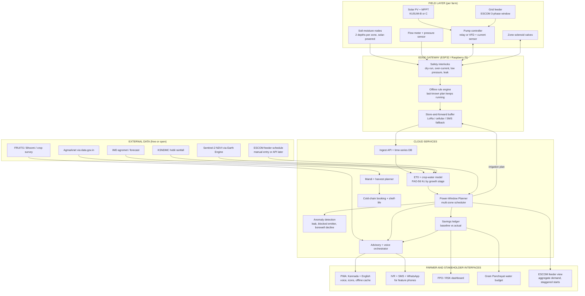
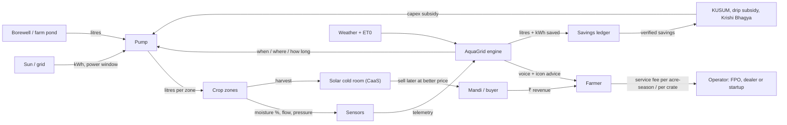

# AquaGrid / FarmHub: Refined Architecture & Winning Improvements

> Prepared 4 Oct 2026 for Challenge 01 (Sustainable Agriculture: Energy, Water & Productivity), Karnataka focus, Kannada + English.  
> Source tags like **[S3]** point to the reference list at the end. Anything marked **ASSUMPTION** is a placeholder you must replace with pilot or KVK data before presenting it as fact.

---

## 0. Executive verdict

**Your current prototype is a strong, farmer-friendly irrigation dashboard. As a hackathon submission it covers about 40% of what the challenge asks for.**

| Challenge deliverable | Status today | Gap |
|---|---|---|
| Solution write-up (how it works, assumptions, why it suits Indian smallholders) | README only | Needs a proper write-up with stated assumptions |
| Architecture / flow diagram (data, energy, money) | Folder tree only | Needs a real system diagram (Section 3) |
| Design artifacts (wireframes, data model, service design) | None | Data model + service blueprint (Sections 3.4, 6) |
| Prototype / simulation | ✅ Good (React, sim loop) | Sim is fixed-step; no real decision engine or baseline comparison |
| **Quantified benefit vs. stated baseline** | ❌ Missing | Biggest gap. Judges explicitly ask for it (Section 5) |
| **Deployment & scale-up plan with unit economics** | ❌ Missing | Section 6 |
| Post-harvest loss | ❌ Not addressed | One of the four stated objectives (Section 4, F7) |
| Climate resilience | Partial (rain advisory) | Needs drought mode, heat stress, insurance evidence |

**Three strategic moves that matter more than any single feature:**

1. **Re-anchor the energy story on Karnataka's real problem: rationed, shifting power windows, not "is solar available".** Pump power is limited to roughly 6 to 7 hours a day. It was cut from 7 to 6 hours and split into two shifts in the current drought **[S3]**. BESCOM supplies "3-phase in batches" where continuous daytime supply isn't technically feasible **[S5]**. Your "Can I water now? YES" card is too binary. Replace it with a **Power-Window Planner** (F1).
2. **Make groundwater the hero metric in Kolar–Chikkaballapur.** Kolar extracts about 193% of recharge and Chikkaballapur about 164% **[S6]**. 45 taluks are over-exploited **[S8]**. Karnataka's own planning panel recommended borewell flow meters, panchayat water budgets and "borewell health cards" **[S7]**. Your flow meter already exists. Turn it into a Gram Panchayat Water Budget (F5).
3. **Show a counterfactual.** For every irrigation event, show *what a farmer-timed schedule would have used* vs. what AquaGrid used. That one screen turns the dashboard into the "quantified benefit vs baseline" evidence the rubric asks for (F3).

**Timing hook for your pitch:** IMD's district summary dated 19 Sep 2026 shows cumulative season rainfall roughly 27–32% below normal across Karnataka's meteorological subdivisions **[S9]**, and farm power has just been cut. Your pitch is about *this season*.

---

## 1. Karnataka context to build on

These are the policy and data hooks that make the solution feel "built for Karnataka" rather than generic.

| Hook | What the research found | How AquaGrid uses it |
|---|---|---|
| **Feeder-level solarisation** | Karnataka's 2026-27 budget launched Mukhya Mantri Saura Krishi Yojane: 3 GW of feeder solarisation at KPTCL substations (RESCO model, ~₹10,500 crore), plus 2,777 MW under PM-KUSUM-C this year and a 4 GW "Anantha" solar-microgrid plan across gram panchayats **[S1]** | Daytime power windows are about to become more predictable. Design the scheduler to ingest a feeder's *solar-backed window* |
| **BESCOM scale** | PPAs for 1,159.1 MW covering 2,79,043 pump sets; e.g. a 13 MW substation serving 3,000 pump sets across 27 villages **[S2]** | Realistic "feeder cohort" for the scale-up story |
| **Off-grid solar pumps** | Energy minister reported 50% subsidy (up from 30%) for KUSUM-B pumps >500 m from the grid **[S4]**. **Verify the current figure before quoting.** | Target segment for the energy-aware mode |
| **PM-KUSUM 2.0** | Reported as planned, with battery storage and a 10 GW agri-PV component **[S21]** (secondary source) | Roadmap slide: scheduler already handles storage + export |
| **Groundwater stress** | Kolar 193%, Chikkaballapur 164%, Bengaluru Rural 147%, Chitradurga 144% extraction **[S6]**; "Water is Future" project covering 525 gram panchayats in critical taluks **[S6]** | Pilot geography + a policy partner story |
| **Farmer identity** | FRUITS gives a once-in-a-lifetime farmer ID linked to Bhoomi land records, crop survey and weather; registration via Raitha Samparka Kendras (RSKs) **[S11]** | Login with FRUITS ID or mobile number; auto-fill plot, crop and sowing date |
| **Weather data** | KSNDMC hobli/taluk-level rainfall published as open CSV **[S10]**. IMD publishes an agromet API and North Karnataka agromet bulletins **[S10]** | Rain-skip logic and ET₀ inputs without paid APIs |
| **Mandi prices** | Agmarknet (data.gov.in) publishes daily modal/min/max prices by APMC, including Kolar **[S12]** | Sell-or-store advisor (F7) |
| **Existing subsidy ecosystem** | Krishi Bhagya (farm ponds, sprinklers) and drip/sprinkler subsidies run through the Agriculture Department; one district page cites 90% subsidy on drip/sprinkler **[S23]** | "Which scheme am I eligible for?" assistant (F9). Verify rates per category |

---

## 2. Design principles (keep these, tighten them)

1. **One screen, one decision.** The farmer should see one action, one reason, one button. Keep this.
2. **Voice and icons first, text second.** Assume low literacy and a bright, dusty, one-handed environment.
3. **Offline-first.** Safety logic runs on the edge gateway. The phone app shows cached state when 2G drops.
4. **Explain the "why" in one sentence**, in Kannada, spoken aloud.
5. **Never let the AI be the only safety layer.** Interlocks (dry-run, over-current, low pressure, leak) live in the controller, not the cloud.
6. **Honest numbers.** Every claim carries a baseline and a source, and every sensor reading carries a confidence indicator.

---

## 3. Refined system architecture

### 3.1 Layered view



### 3.2 Data, energy and money flows (the diagram the challenge asks for)



### 3.3 The Core Hardware: Low-Cost Retrofit Pump Intelligence & Protection Controller

To achieve widespread smallholder adoption without requiring farmers to discard expensive existing switchgear, AquaGrid is engineered as a **low-cost retrofit unit that sits directly alongside the farmer's existing starter box (DOL / Star-Delta)**:

```
┌─────────────────────────────────────────────────────────────┐
│                 EXISTING STARTER BOX (DOL)                  │
│  [Main 3-Phase Contactor]   [Overload Relay]   [Start/Stop] │
└──────────────┬───────────────────────────────────┬──────────┘
               │ (Non-invasive 4-wire control tap) │
               ▼                                   ▼
┌─────────────────────────────────────────────────────────────┐
│   AQUAGRID LOW-COST RETROFIT INTELLIGENCE & PROTECTION      │
│                                                             │
│  ⚡ ELECTRICAL MONITORING:                                   │
│    • 3-Phase Voltage (Under/Over-voltage, Single-phasing)   │
│    • Current Sensing CTs (Dry-run undercurrent, Overload)   │
│    • Power Factor & Phase Reversal Detection                │
│                                                             │
│  💧 HYDRAULIC MONITORING:                                   │
│    • In-line Pressure Transducer (Burst line, Clog, Low-P)  │
│    • Pulse Flow Meter (L/min discharge & volume delivered)  │
│    • Cavitation & Dry-Run Protection (trips in <10s)        │
│                                                             │
│  🧠 AUTONOMOUS EDGE INTELLIGENCE (ESP32):                   │
│    • WHEN TO IRRIGATE: Solar peak + BESCOM 3-phase windows, │
│      auto rain-skip via IMD/KSNDMC telemetry                │
│    • HOW LONG TO IRRIGATE: Soil VWC deficit × Crop stage Kc │
│    • SAFETY INTERLOCK: Hardware contactor disconnect        │
│    • HARD OVERRIDE: Physical starter pushbuttons preserved  │
└─────────────────────────────────────────────────────────────┘
```

1. **Non-Invasive Retrofit Form-Factor**:
   - Sits on the pump house wall right next to standard L&T / Havells / BCH starters.
   - Wires in parallel with the contactor coil and stop circuit using a 4-wire harness.
   - **Zero rewiring of high-voltage power mains**; existing thermal relays and manual start/stop buttons remain 100% operational as a hard physical override.

2. **Dual-Domain Electrical & Hydraulic State Telemetry**:
   - **Electrical State**: Continuously samples 3-phase voltage and phase-wise current. Automatically trips the pump on single-phasing, extreme voltage sag (<340V), or sudden current spikes before motor coils burn.
   - **Hydraulic State**: Reads discharge pipe pressure and flow velocity. If the pump runs but flow drops (dry borewell cavitation) or pressure collapses (pipe burst), the controller opens the starter contactor in under 10 seconds.

3. **Closed-Loop "When & How Long" Autonomous Decisions**:
   - **When**: Ingests solar MPPT generation and BESCOM batch windows; checks rain forecasts from KSNDMC/IMD to prevent watering before showers.
   - **How Long**: Computes exact volumetric crop replenishment ($m^3$) using real-time root-zone depletion and FAO-56 crop growth stage ($K_c$). Automatically shuts off the pump when target litres or optimal soil field capacity is attained.

### 3.4 Repo-level architecture & Implemented Code Structure

```
aquagrid-dashboard/
├── src/
│   ├── utils/
│   │   └── speech.js                # Web Speech API utility (Kannada/English TTS & STT)
│   ├── translations/
│   │   └── translations.js          # Bilingual dictionary (English & Kannada)
│   ├── data/
│   │   └── mockData.js              # Kolar-Chikkaballapur zone profiles & telemetry
│   ├── components/
│   │   ├── VoiceAssistant.jsx       # Feature F2: Audio voice assistant (Ask AquaGrid)
│   │   ├── PowerWindowPlanner.jsx   # Feature F1: BESCOM 6h batch power planner & cut demo
│   │   ├── SavingsLedger.jsx        # Feature F3: Quantified savings ledger vs baselines B1/B2
│   │   ├── BorewellHealthCard.jsx   # Feature F5: Borewell card & Gram Panchayat water budget
│   │   ├── MandiColdRoomAdvisor.jsx # Feature F7: Kolar APMC tomato advisor & cold room CaaS
│   │   ├── ScenariosBar.jsx         # Section 7: 1-click pitch demo scenarios
│   │   ├── IrrigationRecommendation.jsx # What to do now + Audio listen playback
│   │   ├── ZoneCard.jsx             # Color-coded crop cards
│   │   ├── SummaryCards.jsx         # Farm KPI cards
│   │   ├── WeatherCard.jsx          # Microclimate alerts
│   │   ├── EnergyCard.jsx           # Solar power status
│   │   ├── SystemHealth.jsx         # Diagnostics & fault simulation
│   │   ├── ManualControl.jsx        # Manual override & Emergency stop
│   │   ├── History.jsx              # Irrigation ledger
│   │   └── Header.jsx               # Brand & Language toggle (EN ⇄ ಕನ್ನಡ)
│   ├── App.jsx                      # Central simulation engine & state coordinator
│   └── index.css                    # Responsive high-contrast design system
```

### 3.4 Minimal data model

```text
Farmer(id, fruits_id?, mobile, language, village, hobli, taluk, district)
Plot(id, farmer_id, survey_no, area_ha, soil_type, source: borewell|pond|canal,
     pump_kw, pump_head_m, emitter: drip|sprinkler|flood, lat, lon)
Zone(id, plot_id, crop, variety, sowing_date, growth_stage, area_ha, valve_id,
     fc_pct, pwp_pct, root_depth_cm, mad_fraction)
Sensor(id, zone_id, depth_cm, type, calib_offset, calib_gain, last_seen, battery_v)
Reading(sensor_id, ts, vwc_pct, temp_c, confidence)
FlowReading(plot_id, zone_id, ts, litres, pressure_kpa)
PowerWindow(plot_id|feeder_id, start_ts, end_ts, source: grid|solar|hybrid, phase: 1|3, confidence)
IrrigationEvent(id, zone_id, start_ts, end_ts, litres, kwh, trigger: auto|manual|voice,
                baseline_litres, baseline_kwh)           # <-- enables counterfactual
Alert(id, plot_id, type, severity, ts, ack_ts?)
Harvest(id, zone_id, ts, crates, grade)
StorageBooking(id, harvest_id, facility_id, in_ts, planned_out_ts, fee)
PriceTick(market, commodity, ts, min, max, modal, arrivals)
```

---

## 4. Feature improvements & Implemented Modules

| # | Feature | Priority | Implementation Status | Challenge Criterion |
|---|---|---|---|---|
| F1 | Power-Window Planner | **P0** | ✅ **Built** (`PowerWindowPlanner.jsx`) | Energy, Smallholder |
| F2 | Voice-first Kannada + English Audio ("Ask AquaGrid") | **P0** | ✅ **Built** (`VoiceAssistant.jsx`, `speech.js`) | Smallholder, Rural UX |
| F3 | Savings Ledger with baseline counterfactual | **P0** | ✅ **Built** (`SavingsLedger.jsx`) | Energy/Water (Quantified Benefit) |
| F4 | Drought Mode (deficit irrigation by growth stage) | **P0** | ✅ **Built** (Scenarios Bar + Drought banner) | Climate Resilience |
| F5 | Borewell Health Card + Gram Panchayat Water Budget | P1 | ✅ **Built** (`BorewellHealthCard.jsx`) | Energy, Climate |
| F6 | Tiered product: Lite (no sensors) / Sensor / Solar+Valve | P1 | Architectural roadmap | Smallholder Accessibility |
| F7 | Harvest-to-Market: sell-or-store advisor + cold-chain booking | P1 | ✅ **Built** (`MandiColdRoomAdvisor.jsx`) | Post-Harvest Loss Prevention |
| F8 | Feature-phone channel: IVR + SMS + WhatsApp | P1 | Architectural spec | Smallholder Access |
| F9 | Scheme & subsidy finder (KUSUM, drip, Krishi Bhagya) | P2 | Architectural spec | Smallholder |
| F10 | Crop-health: satellite NDVI alerts + photo diagnosis | P2 | Architectural spec | Climate |
| F11 | Insurance evidence pack (PMFBY) | P2 | Architectural spec | Climate |
| F12 | ESCOM feeder view with staggered starts | P2 | Architectural spec | Grid Protection |

---

## 🔊 Audio Speech Feature Details (Feature F2)

AquaGrid provides a **full voice-first rural interface** using Web Speech API technologies:
- **Speech Synthesis (TTS)**: Reads advice aloud in natural **Kannada (`kn-IN`)** and **English (`en-IN`)**.
- **Interactive Audio Buttons (🔊)**: Present on:
  - **"What to do now" Recommendation Card**: Speaks the recommended zone, required volume, and agronomic reason.
  - **Power-Window Planner**: Speaks the batch timings and power cut alerts.
  - **Savings Ledger**: Speaks verified water/pump-hour conservation stats.
  - **Borewell Health Card**: Speaks aquifer health and discharge metrics.
  - **Mandi & Cold Storage Advisor**: Speaks market price alerts and distress sale warnings.
- **Voice Assistant ("Ask AquaGrid / ಧ್ವನಿ ಸಹಾಯಕ")**:
  - Push-to-talk microphone button with live recording audio wave feedback.
  - Preset one-tap Kannada/English rural queries:
    - *"Should I water today? / ಇವತ್ತು ನೀರು ಹಾಕಬೇಕಾ?"*
    - *"When is BESCOM power available? / ಪವರ್ ಯಾವಾಗ ಸಿಗುತ್ತೆ?"*
    - *"How is my borewell health? / ಬೋರ್‌ವೆಲ್ ಸ್ಥಿತಿ ಹೇಗಿದೆ?"*
    - *"What is tomato price in Kolar? / ಕೋಲಾರ ಮಂಡಿಯಲ್ಲಿ ಟೊಮ್ಯಾಟೊ ಬೆಲೆ ಎಷ್ಟು?"*
    - *"How much water did I save this week? / ಈ ವಾರ ಎಷ್ಟು ನೀರು ಉಳಿತಾಯವಾಯಿತು?"*

---

## 5. Quantified benefit: Evidence & Per-Hectare Model

### 5.1 Evidence from Literature

| Claim | Reported range | Source |
|---|---|---|
| Drip vs furrow, tomato: water saved | ~17–56% (e.g. ~35% less water, +28% yield in one study) | **[S15]** |
| Sensor/IoT-based scheduling vs ET-based scheduling | ~18% water saving, similar yield | **[S15]** |
| IoT drip vs conventional ETc-based drip (eggplant) | 35.2% water saving, 12% higher yield | **[S17]** |
| Sensor-guided irrigation in commercial fields | +11% yield, +12% net return on average vs companion fields | **[S16]** |

### 5.2 Illustrative per-hectare model (**Kolar Tomato Pilot**)

| Parameter | Value | Basis |
|---|---|---|
| Crop | Tomato, 1 ha, Kolar belt | |
| Seasonal irrigation, baseline | 5,000 m³/ha (≈ 500 mm) | **ASSUMPTION** (to verify with KVK) |
| Water saved by AquaGrid vs B2 (drip on timer) | 15–25% → 750–1,250 m³/ha | Conservative end of literature **[S15, S17]** |
| Pump head (incl. drawdown) | 100 m | Average Kolar deep borewell |
| Pump + motor efficiency | 35% | Field average |
| Energy per m³ | `E = 100 / (367 × 0.35) ≈ 0.78 kWh/m³` | Hydraulic energy formula |
| **Energy saved** | **≈ 580–975 kWh/ha/season** | = water saved × 0.78 |
| Yield effect | +5–10% | Below literature to remain conservative |

---

## 6. Deployment & Scale-up Plan

### 6.1 Target Geographies
- **Phase 1 Pilot (0–6 mo)**: Kolar & Chikkaballapur (highest groundwater stress **[S6]**, 193% extraction, tomato/chilli/beans).
- **Phase 2 Expansion (6–18 mo)**: Tumakuru, Chitradurga, Bengaluru Rural (Krishi Bhagya farm ponds, over-exploited taluks).
- **Phase 3 Feeder Scale (18–36 mo)**: North Interior Karnataka KUSUM-C feeder solarisation clusters **[S1, S9]**.

### 6.2 Unit Economics Template
- **Advisory Subscription (Lite)**: ₹/acre/season (funded via FPO / CSR / B2B2C).
- **Sensor Tier**: Low-cost capacitive probe (BOM ≈ $10 + $6 solar node **[S18]**).
- **Cold-Room CaaS Fees**: ₹10 per 50 kg crate (benchmarked against Sindhanur FPO model **[S13]**).

---

## 7. 2-Minute Pitch Demonstration Flow (Scenarios Bar)

Use the top **Demo Scenarios Bar** to demonstrate real-world Karnataka farm resilience:
1. **Normal Day**: Displays baseline recommendation, solar status, and savings ledger.
2. **BESCOM Power Cut**: Power window shrinks from 6h to 3h; planner dynamically prioritizes Zone 2 Tomato and speaks re-allocation advice aloud.
3. **Drought Mode**: Deficit irrigation flag engages; system conserves water in non-critical vegetative crops.
4. **Pipe Leak Anomaly**: Pressure drop triggers pump interlock and safety alert in Kannada/English.
5. **APMC Price Crash**: Modal price alert triggers cold storage recommendation to prevent distress selling.
6. **Voice Query**: Click the Mic button or voice chips to hear spoken responses in Kannada or English.

---

## 8. Reference list

- **[S1]** Renewable Watch, Karnataka feeder-level solarisation in state budget 2026-27 (10 Mar 2026). https://renewablewatch.in/2026/03/10/karnataka-introduces-new-feeder-level-solarisation-programme-in-state-budget-2026-27/
- **[S2]** BESCOM PM-KUSUM-C PPAs (1,159.1 MW; 2,79,043 pump sets). https://www.superprep.io/current-affairs/pm-kusum-c-karnataka-solarised-pumps-11591-mw-ppas
- **[S3]** Asianet News, farm power cut from 7 to 6 hours in two shifts amid drought. https://newsable.asianetnews.com/karnataka-news/karnataka-power-shortage-amid-drought-farm-power-supply-cut-farmers-stay-up-at-night-articleshow-493ylbo
- **[S4]** India.com, KUSUM-B 50% subsidy and 7-hour daytime power commitment. https://www.india.com/news/india/karnataka-government-siddaramaiah-farmers-dk-shivakumar-kj-george-farmers-solar-plants-kusum-b-scheme-congress-bjp-electricity-bengaluru-energy-minister-8071640/
- **[S5]** BESCOM, Power supply to agricultural feeders. https://bescom.karnataka.gov.in/page/Departments+of+Corporate+Office/Operations/Power+Supply+to+Agri+feeders/en
- **[S6]** Deccan Herald, groundwater extraction by district; "Water is Future" project. https://www.deccanherald.com/amp/story/india%2Fkarnataka%2Fbengaluru%2Fbengaluru-urban-among-5-districts-with-100-plus-groundwater-extraction-3757568
- **[S7]** Deccan Herald, Karnataka planning panel on water security (borewell monitoring, health cards). https://www.deccanherald.com/india/karnataka/karnataka-planning-panel-pushes-for-water-security-3915876
- **[S8]** SANDRP, Groundwater 2025: depletion and contamination. https://sandrp.in/2026/03/25/groundwater-2025-depletion-and-contamination-rising/
- **[S9]** IMD, district-wise rainfall summary dated 19 Sep 2026. https://mausam.imd.gov.in/bengaluru/mcdata/cum_stats.pdf
- **[S10]** KSNDMC open data (OpenCity): https://data.opencity.in/dataset/karnataka-annual-rainfall-districts-taluks-and-hoblis · IMD API: https://api.imd.gov.in/public/api_reference.html
- **[S11]** NIC, FRUITS (Karnataka farmer registry). https://www.nic.gov.in/project/fruits/
- **[S12]** Kolar tomato prices via Agmarknet: https://acrop.app/mandi/karnataka/kolar/kolar/tomato
- **[S13]** Mongabay India, solar cold storage for smallholders (Sindhanur FPO; MIDH/RKVY subsidy). https://india.mongabay.com/2025/11/solar-powered-cold-storage-empowers-smallholder-farmers/
- **[S14]** Panorama Solutions, Cooling-as-a-Service pilot (GIC + CoolCrop). https://panorama.solutions/en/solution/affordable-access-solar-powered-cold-storages
- **[S15]** Wiley, Irrigation and Water Management of Tomatoes: A Review. https://onlinelibrary.wiley.com/doi/10.1002/sae2.70020
- **[S16]** Sensor-guided smart irrigation for tomato (commercial-field results). https://www.researchgate.net/publication/390653014_Sensor-Guided_Smart_Irrigation_for_Tomato_Production_Comparing_Low_and_Optimum_Soil_Moisture_in_Greenhouse_Environments
- **[S17]** Nature Scientific Reports, wireless sensor network for drip irrigation (eggplant). https://www.nature.com/articles/s41598-025-97303-w
- **[S18]** Low-cost capacitive sensor calibration: https://doi.org/10.3390/s26113291 · Indian sugarcane field calibration: https://www.nature.com/articles/s41598-024-81288-z
- **[S19]** Bhashini/Sarvam multilingual speech tooling: https://pypi.org/project/indic-language-utils/ · Sarvam agri voice-agent guide: https://docs.sarvam.ai/api/api-guides-tutorials/speech-to-text/use-cases/agri-rural
- **[S20]** Sentinel-2 / Earth Engine for ET and crop water stress: https://www.ncbi.nlm.nih.gov/pmc/articles/PMC13416505/
- **[S21]** PM-KUSUM 2.0 plans. https://sarkariyojana.com/pm-kusum-yojana/
- **[S22]** Kissan-Dost, conversational IoT for smallholders (node costs). https://arxiv.org/pdf/2602.08593
- **[S23]** Chitradurga district agriculture page (Krishi Bhagya; drip/sprinkler subsidy). https://chitradurga.nic.in/en/agriculture/
- **[S24]** Crop price forecasting and Kolar tomato volatility: https://arxiv.org/pdf/2009.04171
